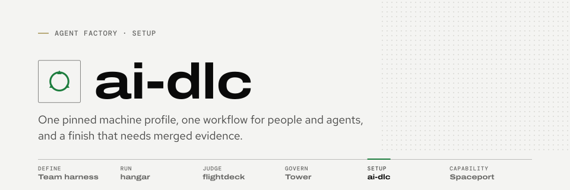
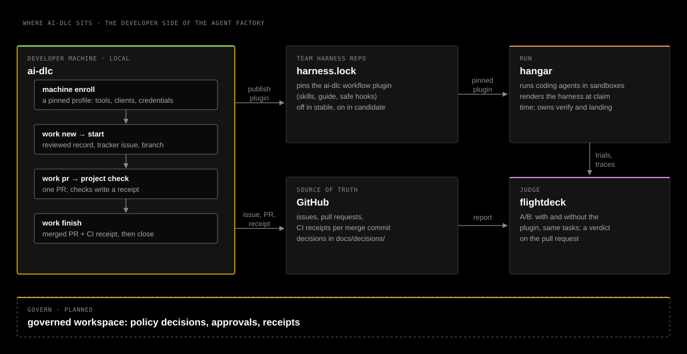

<picture>
  <source media="(prefers-color-scheme: dark)" srcset="docs/assets/brand/banner-dark.svg">
  
</picture>

# AI-DLC

**Every developer's machine is set up differently, and every coding agent closes tickets on
its own idea of "done".** AI-DLC gives a team one pinned machine profile, one workflow its
agents follow in Claude Code or Codex, and a `work finish` that closes a ticket only when the
merged commit has a passing CI receipt.

Docs site: <https://sean-koval.github.io/ai-dlc/> · Part of the
[agent factory](https://sean-koval.github.io/agent-factory/) (Run / Judge / Govern / Define).

> **Scope freeze (2026-10).** AI-DLC is a local workflow, machine-provisioning and
> work-lifecycle tool. Features outside the in-scope list in
> [ADR 0001](docs/decisions/0001-refocus-ai-dlc.md) are frozen; bug fixes are welcome.
> `ai-dlc eval` moved to flightdeck.

## See it work

Enroll a machine from a pinned profile (preview, apply, status):


Take one piece of work from a reviewed record to a closed ticket. GitHub is played by a
local stand-in ([`demo_provider.py`](docs/assets/front/demo_provider.py)) that speaks the
provider contract, so the gates below check a real local merge and the receipt
`project check` wrote:


## What it looks like

The workflow plugin's skills, as Claude Code lists them, and the checks a project requires:


## Where it sits

<picture>
  <source media="(prefers-color-scheme: light)" srcset="docs/assets/front/suite-light.svg">
  
</picture>

AI-DLC does not run agents in the cloud or judge harnesses: hangar renders and runs
sandboxes, flightdeck evaluates, and AI-DLC authors the one optional plugin they pin.

## Use cases

- **A new engineer is productive on day one.** They enroll their laptop from the team's
  profile at a reviewed tag: the same runtimes, Claude Code and Codex settings and named
  credentials as everyone else, with their own paths and accounts. `machine status` shows
  what drifted later.
- **An agent cannot declare victory early.** A developer and their agent take an issue
  through `work start` and `work pr`; `work finish` refuses until the PR is merged into the
  target branch and that merge commit has a passing CI receipt, then closes the issue.
- **A team measures whether its workflow helps.** The maintainer publishes the workflow
  plugin into the team harness (`scripts/publish_workflow_plugin.py`), off in `stable` and on
  in `candidate`, and flightdeck compares agent runs with and without it.

## Get started

Needs git and curl on macOS or Linux (native Windows is not supported yet). Five commands,
from a fresh machine to a project whose required checks pass:

```sh
git clone https://github.com/Sean-Koval/ai-dlc.git && cd ai-dlc
sh scripts/bootstrap.sh --source
export PATH="$HOME/.local/share/ai-dlc/bootstrap/bin:$PATH"
ai-dlc project init ~/demo-app && cd ~/demo-app && git init -q && ai-dlc project setup --root .
git add -A && git commit -qm "chore: initialize with ai-dlc" && ai-dlc project check --required
```

Bootstrap installs pinned uv, Python and mise; no preinstalled Python or Node is needed.
To use AI-DLC in an existing work repository, connect GitHub, enroll a profile or
contribute to the engine, follow [Get started](docs/workflows/get-started.md) on the docs site.

Try the workflow plugin in Claude Code from this checkout. It is off by default, so enable it
for the session; `claude plugin list` with the same flags should report `Status: √ loaded`:

```sh
claude --plugin-dir plugins/ai-dlc-workflow --settings '{"enabledPlugins":{"ai-dlc-workflow@inline":true}}'
```

## Features

| Feature | What you get | Read more |
| --- | --- | --- |
| Machine enrollment | Versioned profiles pin runtimes, tools, agent clients and named credentials; each machine keeps its own paths and accounts | [Machine enrollment](docs/runbooks/machine-enrollment.md) |
| Project scaffolding | `project init` / `project adopt` for generic, Python, Node or Rust repositories, with setup steps and required checks | [Get started](docs/workflows/get-started.md) |
| Workflow plugin | Guidance, ten team skills and CLI-optional safety hooks for Claude Code, with a Codex form; off by default | [Plugin README](plugins/ai-dlc-workflow/README.md) |
| Work lifecycle | Reviewed work records bind an issue, branch, specification and PR; `work finish` gates on the merge and its CI receipt | [Development workflow](docs/development-workflow.md) |
| Receipts | `project check --required` runs the team's checks and writes a receipt bound to the commit | [Release verification](docs/release-verification.md) |
| Documentation upkeep | Catalog, impact review, dispositions and a docs gate; decision records with knowledge-note frontmatter | [Project documentation](docs/design/project-documentation.md) |
| Agent access | `ai-dlc mcp serve` exposes reviewed work, documentation and knowledge tools to agents | [Workflow tool map](docs/workflows/tool-map.md) |
| Providers | GitHub Issues + Projects (default), Jira Cloud, OpenSpec, Obsidian | [Architecture](docs/architecture.md) |

The front-page recordings and screens are generated by
[`docs/assets/front/build.py`](docs/assets/front/build.py), which runs the real CLI; CI
fails when they are stale.

## Go deeper

- [Get started](docs/workflows/get-started.md): setup routes, configuration, team guidance across machines and example workflows.
- [Architecture](docs/architecture.md): services, configuration layers and extension points.
- [Development workflow](docs/development-workflow.md): discovery, greenfield, brownfield and design review.
- [Verification status](docs/release-verification.md): platform and provider evidence and the remaining qualification gaps.
- [Documentation map](docs/index.md): every canonical document.
