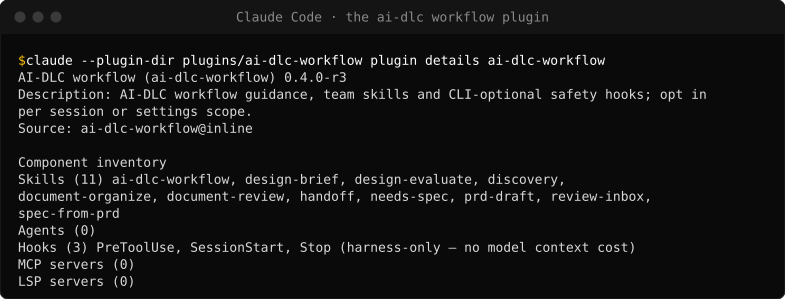
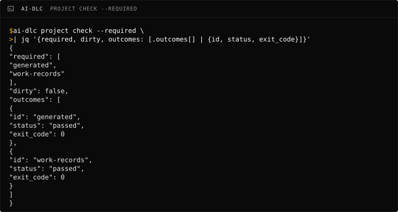

---
hide:
  - navigation
  - toc
---

<div class="af-hero af-hero--visual" markdown>
<div markdown>
<span class="af-eyebrow">Agent factory · Setup</span>

# One setup, one workflow, one evidence-gated finish

<p class="af-lede">ai-dlc pins every machine to one profile and gives agents one workflow in Claude Code or Codex. It closes a ticket only when the merged commit has a passing CI receipt.</p>

[Get started](workflows/get-started.md){ .md-button .md-button--primary } [Suite overview](https://sean-koval.github.io/agent-factory/){ .md-button }
</div>
<figure class="af-hero__visual">
<picture>
<source media="(max-width: 600px)" srcset="assets/front/work-phone.svg" width="379" height="418">

</picture>
<figcaption>work finish refused while the PR is open, then completed: the CI receipt passed and issue 42 closed. <a href="assets/front/clip.mp4">Watch a new project pass its required checks (20 s)</a>.</figcaption>
</figure>
</div>

## See it work

<figure class="af-figure dlc-native" style="--dlc-native: 691px">
<picture>
<source media="(max-width: 600px)" srcset="assets/front/enroll-phone.svg" width="379" height="265">

</picture>
<figcaption>machine enroll applied the pinned profile; machine status shows one credential not yet bound</figcaption>
</figure>

The work recording in the hero takes one reviewed record from `work start` to a closed ticket.
GitHub and its CI are a
[local stand-in](https://github.com/Sean-Koval/ai-dlc/blob/main/docs/assets/front/demo_provider.py)
that speaks the provider contract. The gates check a real local merge and the receipt
`project check` wrote.

## What it looks like

The workflow plugin's skills, as Claude Code lists them, and the checks a project requires:



<picture>
<source media="(max-width: 600px)" srcset="assets/front/project-check-phone.svg" width="379" height="435">

</picture>

## Where it sits

--8<-- "docs/assets/front/suite.svg"

ai-dlc does not run agents in the cloud or judge harnesses. hangar renders and runs
sandboxes, flightdeck evaluates, and ai-dlc authors the one optional plugin they pin.

## Use cases

- **A new engineer is productive on day one.** They enroll their laptop from the team's
  profile at a reviewed tag. They get everyone's runtimes, Claude Code and Codex settings and
  named credentials, with their own paths and accounts. `machine status` shows
  what drifted later.
- **An agent cannot declare victory early.** A developer and their agent take an issue
  through `work start` and `work pr`; `work finish` refuses until the PR is merged into the
  target branch and that merge commit has a passing CI receipt, then closes the issue.
- **A team measures whether its workflow helps.** The maintainer publishes the workflow
  plugin into the team harness, off in `stable` and on in `candidate`. flightdeck compares
  agent runs with and without it.

## Quickstart

Needs git and curl on macOS or Linux (native Windows is not supported yet). These commands
take a fresh machine to a project whose required checks pass.

```sh
git clone https://github.com/Sean-Koval/ai-dlc.git
cd ai-dlc
sh scripts/bootstrap.sh --source
export PATH="$HOME/.local/share/ai-dlc/bootstrap/bin:$PATH"
ai-dlc project init ~/demo-app
cd ~/demo-app
git init -q
ai-dlc project setup --root .
git add -A
git commit -qm "chore: initialize with ai-dlc"
ai-dlc project check --required
```

[Get started](workflows/get-started.md) covers existing work repositories and contributing;
[Configure a project](workflows/configure.md) covers GitHub and profiles.

## Features

| Feature | What you get | Read more |
| --- | --- | --- |
| Machine enrollment | Versioned profiles pin runtimes, tools, agent clients and named credentials; each machine keeps its own paths and accounts | [Machine enrollment](runbooks/machine-enrollment.md) |
| Project scaffolding | `project init` / `project adopt` for generic, Python, Node or Rust repositories, with setup steps and required checks | [Get started](workflows/get-started.md) |
| Workflow plugin | Guidance, eleven skills and CLI-optional safety hooks for Claude Code, with a Codex form; off by default | [Workflow plugin](workflows/workflow-plugin.md) |
| Work lifecycle | Reviewed work records bind an issue, branch, specification and PR; `work finish` gates on the merge and its CI receipt | [Development workflow](development-workflow.md) |
| Receipts | `project check --required` runs the team's checks and writes a receipt bound to the commit | [Release verification](release-verification.md) |
| Documentation upkeep | Catalog, impact review, dispositions and a docs gate; decision records with knowledge-note frontmatter | [Project documentation](design/project-documentation.md) |
| Agent access | `ai-dlc mcp serve` exposes reviewed work, documentation and knowledge tools to agents | [Workflow tool map](workflows/tool-map.md) |
| Providers | GitHub Issues + Projects (default), Jira Cloud, OpenSpec, Obsidian | [Architecture](architecture.md) |

## Read next

| Question | Page |
| --- | --- |
| How do I set up a new or existing repository? | [Get started](workflows/get-started.md) |
| How does a piece of work go from ticket to finish? | [Development workflow](development-workflow.md) |
| Which command or skill does each stage use? | [Workflow tool map](workflows/tool-map.md) |
| How is the system built, and what are its parts? | [Architecture](architecture.md) |
| What is in scope, and what is frozen? | [ADR 0001](decisions/0001-refocus-ai-dlc.md) and [Roadmap](roadmap.md) |
| What was verified in the current release? | [Release verification](release-verification.md) |
