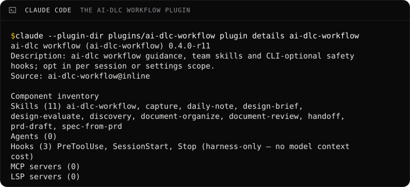
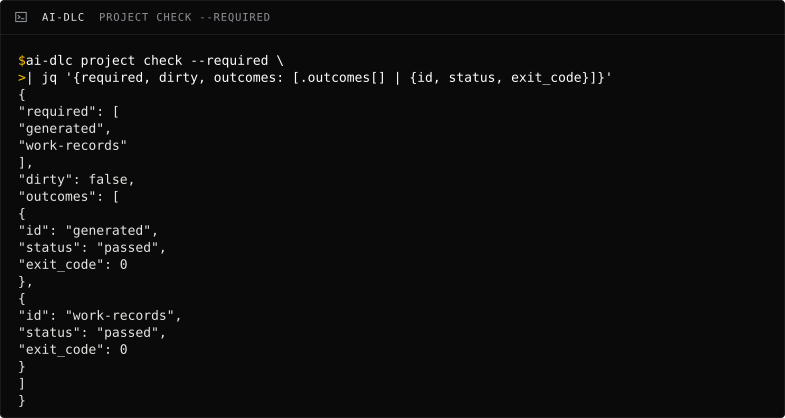

---
hide:
  - navigation
  - toc
---

<div class="af-hero af-hero--visual" markdown>
<div markdown>
<span class="af-eyebrow">Agent factory · Setup</span>

# One setup, one workflow, one evidence-gated finish

<p class="af-lede">ai-dlc pins every machine to one profile and gives agents one workflow in Claude Code or Codex. It closes a ticket only when the merged commit has a passing CI receipt.</p>

[Get started](workflows/get-started.md){ .md-button .md-button--primary } [Suite overview](https://sean-koval.github.io/agent-factory/){ .md-button }
</div>
<figure class="af-hero__visual">
<picture>
<source media="(max-width: 600px)" srcset="assets/front/work-phone.svg" width="379" height="418">

</picture>
<figcaption>work finish refused while the PR is open, then completed: the CI receipt passed and issue 42 closed. <a href="assets/front/clip.mp4">Watch a new project pass its required checks (20 s)</a>.</figcaption>
</figure>
</div>

## What it does

<div class="af-tools dlc-cols-3">
  <a class="af-tool" href="runbooks/machine-enrollment/"><small>Set up</small><b>A new engineer is productive on day one</b><span>They enroll their laptop from the team's profile at a reviewed tag. They get everyone's runtimes, Claude Code and Codex settings and named credentials, with their own paths and accounts. <code>machine status</code> shows what drifted later.</span></a>
  <a class="af-tool" href="development-workflow/"><small>Finish</small><b>An agent cannot declare victory early</b><span>A developer and their agent take an issue through <code>work start</code> and <code>work pr</code>. <code>work finish</code> refuses until the PR is merged and that merge commit has a passing CI receipt, then closes the issue.</span></a>
  <a class="af-tool" href="workflows/workflow-plugin/"><small>Measure</small><b>A team measures whether its workflow helps</b><span>The maintainer publishes the workflow plugin into the team harness, off in <code>stable</code> and on in <code>candidate</code>. flightdeck compares agent runs with and without it.</span></a>
</div>

## See it work

<figure class="af-figure dlc-native" style="--dlc-native: 691px">
<picture>
<source media="(max-width: 600px)" srcset="assets/front/enroll-phone.svg" width="379" height="265">

</picture>
<figcaption>Set up: machine enroll applied the pinned profile; machine status shows one credential not yet bound</figcaption>
</figure>

The work recording in the hero takes one reviewed record from `work start` to a closed ticket.
GitHub and its CI are a
[local stand-in](https://github.com/Sean-Koval/ai-dlc/blob/main/docs/assets/front/demo_provider.py)
that speaks the provider contract. The gates check a real local merge and the receipt
`project check` wrote.

<figure class="af-figure dlc-native" style="--dlc-native: 691px">

<figcaption>One workflow: the plugin's ten skills and three hooks, as Claude Code lists them</figcaption>
</figure>

<figure class="af-figure dlc-native" style="--dlc-native: 691px">
<picture>
<source media="(max-width: 600px)" srcset="assets/front/project-check-phone.svg" width="379" height="435">

</picture>
<figcaption>Evidence: project check --required on a clean tree, every required check passing</figcaption>
</figure>

## Where it sits

--8<-- "docs/assets/front/suite.svg"

ai-dlc does not run agents in the cloud or judge harnesses. hangar renders and runs
sandboxes, flightdeck evaluates, and ai-dlc authors the one optional plugin they pin.
Read more in the [hangar docs](https://sean-koval.github.io/hangar/), the
[flightdeck docs](https://sean-koval.github.io/flightdeck/) and the
[example team harness](https://github.com/Sean-Koval/team-harness), which pins this plugin ([how to pin it](workflows/workflow-plugin-harness.md)).

## Quickstart

Needs git and curl on macOS or Linux (native Windows is not supported yet). These commands
take a fresh machine to a project whose required checks pass.

```sh
git clone https://github.com/Sean-Koval/ai-dlc.git
cd ai-dlc
sh scripts/bootstrap.sh --source
export PATH="$HOME/.local/share/ai-dlc/bootstrap/bin:$PATH"
ai-dlc project init ~/demo-app
cd ~/demo-app
git init -q
ai-dlc project setup --root .
git add -A
git commit -qm "chore: initialize with ai-dlc"
ai-dlc project check --required
```

[Get started](workflows/get-started.md) covers existing work repositories and contributing;
[Configure a project](workflows/configure.md) covers GitHub and profiles.

## Features

| Feature | What you get |
| --- | --- |
| [Machine enrollment](runbooks/machine-enrollment.md) | Versioned profiles pin runtimes, tools, agent clients and named credentials; each machine keeps its own paths and accounts |
| [Project scaffolding](workflows/get-started.md) | `project init` / `project adopt` for generic, Python, Node or Rust repositories, with setup steps and required checks |
| [Workflow plugin](workflows/workflow-plugin.md) | Guidance, ten skills and CLI-optional safety hooks for Claude Code, with a Codex form; off by default |
| [Work lifecycle](development-workflow.md) | Reviewed work records bind an issue, branch, specification and PR; `work finish` gates on the merge and its CI receipt |
| [Receipts](release-verification.md) | `project check --required` runs the team's checks and writes a receipt bound to the commit |
| [Documentation upkeep](design/project-documentation.md) | Catalog, impact review, dispositions and a docs gate; decision records with knowledge-record frontmatter |
| [Agent access](workflows/tool-map.md) | `ai-dlc mcp serve` exposes reviewed work, documentation and knowledge tools to agents |
| [Providers](architecture.md) | GitHub Issues + Projects (default), Jira Cloud, OpenSpec, Obsidian |

## Read next

<div class="af-tools dlc-cols-3">
  <a class="af-tool" href="workflows/get-started/"><small>Set up a repository</small><b>Get started</b><span>A new project, an existing repository, or the engine itself.</span></a>
  <a class="af-tool" href="development-workflow/"><small>Ticket to finish</small><b>Development workflow</b><span>The stages, what each one leaves behind, and the finish gate.</span></a>
  <a class="af-tool" href="workflows/tool-map/"><small>Commands and skills</small><b>Workflow tool map</b><span>Which command, MCP tool or skill each stage uses.</span></a>
  <a class="af-tool" href="architecture/"><small>How it is built</small><b>Architecture</b><span>Layers, services, provider boundaries and source packages.</span></a>
  <a class="af-tool" href="decisions/0001-refocus-ai-dlc/"><small>Scope and freeze</small><b>ADR 0001</b><span>What is in scope, and what is frozen.</span></a>
  <a class="af-tool" href="release-verification/"><small>Evidence</small><b>Release verification</b><span>What was verified in the current release.</span></a>
</div>
