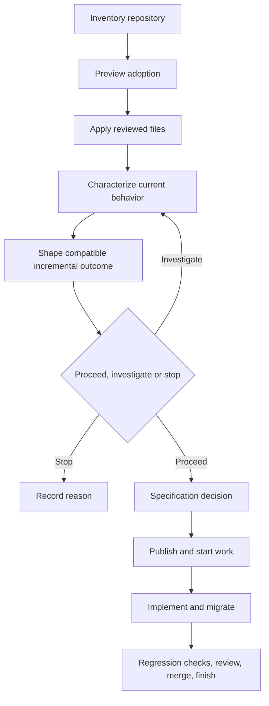

# Brownfield workflow

Bring ai-dlc into an existing repository, or change an existing product, while
preserving its application files and observed behavior.

## Flow



## 1. Inventory before adopting

Identify the deployable application, manifests and lockfiles, module and data
boundaries, public interfaces, CI rules, runbooks and existing documentation.
Record unknown behavior instead of guessing. Find owner-written files that
overlap ai-dlc managed paths before applying a template.

Establish a clean test baseline. Where important behavior lacks tests, add
characterization tests of the current observable contract before changing it.
A characterization test is evidence, not an endorsement of the design.

## 2. Preview and apply adoption

Preview first:

```sh
ai-dlc project adopt --root /path/to/project --preset generic
```

Review every proposed file and conflict, then repeat with `--apply`. Existing
managed-path files are conflicts, user-authored configuration and documentation
included. Adoption presets expect existing manifests and lockfiles and create no
application source; the generic preset installs no language toolchain.

The bundled template can bootstrap a checkout, but portable updates require an
accessible Git template URL and immutable release tag. Copier owns its answers,
source, revision, and three-way update history; never hand-edit that history to
manufacture upgrade support.

## 3. Establish the managed boundary

After adoption, distinguish four areas:

- application code and owner-authored documents that ai-dlc must preserve;
- template-managed workflow files that can receive reviewed updates;
- provider-owned remote state such as specifications, tracker status, and SCM
  evidence;
- machine-local state such as credentials, paths, caches, and journals.

Snapshot and staging omit `.git`, dependency directories, tool caches,
`.ai-dlc/local/` and Git-ignored untracked files. If the checkout changes after
staging, application aborts and asks for a fresh preview. Copier conflicts leave
the original checkout untouched.

<a id="rehearse-a-reviewed-behavior-check"></a>
## 4. Rehearse a reviewed behavior check

[Rehearse a reviewed behavior check](behavior-check.md) shows, in six steps,
that one reviewed check detects one concrete regression.

## 5. Design the incremental change

Use discovery and the [product brief](https://github.com/Sean-Koval/ai-dlc/blob/main/agents/templates/product-brief.md)
to inspect the existing journey, implementation, tests, consumers and public
interfaces. Separate observed behavior, actual user decisions and hypotheses.
Record sources and their limits: fixtures do not prove live integration or
product value.

Follow the [brownfield example](https://github.com/Sean-Koval/ai-dlc/blob/main/agents/examples/product-shaping/brownfield.md).
State affected users, integrations, compatibility boundaries, migration and
recovery needs. Compare feasible options, keeping current behavior among them
when meaningful, by impact, confidence, effort and dependencies. Preserve
explicit constraints. Contradictory requirements stay unresolved until the
responsible owner decides; an additive alternative is a proposal, not approval.

Select a bounded outcome and next slice, with stable OUT-001 and RQ-001 IDs owned
by one brief. End with proceed, investigate or stop and reasons. Investigate
material unknowns before an implementation commitment.

Proceeding within existing authorization, keep old-contract regression
evidence and plan rollout and rollback for affected state. Small work can retain
the brief alone; prd-draft can expand rationale while referencing the same IDs.
Publication requires separate authorization.

Use design methods fit for the increment; UI exploration is optional. Follow
the [design-to-implementation contract](design-to-implementation.md) when it
applies. Record consequential compatibility decisions in an ADR. Prefer
independently releasable slices for a risky transition.

## 6. Specify, publish, and implement

Decide whether changed behavior needs a formal specification. If it does, use
the configured provider or a deliberate local OpenSpec compatibility fallback.
Otherwise record `requires_spec = false` and its reviewed reason.

With tracker and SCM configured, link the design and specification from the
work record, then publish and start through ai-dlc. Otherwise use the local
lifecycle and manual tracking. Implement on the bound branch when available and
preserve unrelated behavior. Add regression tests for old contracts and
acceptance tests for new outcomes.

Preview template updates before applying them. Sync stages the checkout in a
temporary Git repository and asks Copier for the three-way update. Application
files are retained and `.git` metadata is never copied back. Ordinary write
errors roll back, and conflicts leave the destination untouched. A
power-loss-safe multi-file transaction is not claimed.

## 7. Review, migrate, and finish

Review compatibility evidence, migrations, rollback, documentation and the new
behavior, not only the code diff. Always run required checks locally. With
tracker and SCM configured, merge through SCM and observe any configured rollout
evidence. Then `ai-dlc work finish <work-id>` authenticates the merged revision
before completing remote tracker state. Otherwise, close the manual lifecycle
without claiming ai-dlc remote completion.

## Ready and done

Brownfield work is ready when current behavior, compatibility boundaries,
affected owners, incremental design, specification decision, rollback needs and
test strategy are explicit. Local work is done when required old and new
behavior is verified and migrations and runbooks are current. With tracker and
SCM configured, done also means the reviewed PR is merged and ai-dlc accepts
every finish gate.
