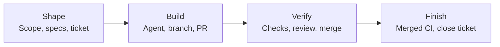

# Get started

Install ai-dlc, set up a project and run its required checks.

## Five commands

Needs git and curl on macOS or Linux. From a fresh machine to a project whose
required checks pass:

```sh
git clone https://github.com/Sean-Koval/ai-dlc.git && cd ai-dlc
sh scripts/bootstrap.sh --source
export PATH="$HOME/.local/share/ai-dlc/bootstrap/bin:$PATH"
ai-dlc project init ~/demo-app && cd ~/demo-app && git init -q && ai-dlc project setup --root .
git add -A && git commit -qm "chore: initialize with ai-dlc" && ai-dlc project check --required
```

Bootstrap installs pinned uv, Python and mise, prepares the checkout and prints
the directories to add to `PATH`; no preinstalled Python or Node is needed. When
the global `ai-dlc` alias belongs to another checkout, use the checkout-specific
executable that bootstrap prints instead.

`project init` copies the template only (`--preset generic|python|node|rust`,
`--agent-client claude-code|codex`). `project setup` runs the setup steps and
renders the agent configuration, so the `generated` check fails until setup has
run; init's output and the failing check both name it.

## Add it to an existing repository

Adopt the repository with the preset that matches it and only the capability you
need. Every command previews first; repeat it with `--apply` to write:

```sh
ai-dlc project adopt --root /path/to/work-repository --preset generic \
  --capability agent-client --agent-client codex
# Inspect the preview, then repeat that exact command with --apply.
ai-dlc project setup --root /path/to/work-repository
ai-dlc agents render --root /path/to/work-repository --apply
ai-dlc project readiness --root /path/to/work-repository
git -C /path/to/work-repository add . && git -C /path/to/work-repository commit -m "chore: adopt ai-dlc"
ai-dlc project check --root /path/to/work-repository --required
```

Preserve the repository's existing checks and add at least one required check for
its own acceptance behavior; the generic management checks do not establish that
behavior. Optional capabilities include `backend` contract checks and `frontend`
browser smoke tests. Checks bind receipts to the repository's `HEAD`.

`ai-dlc project onboard --root PATH --preset generic --agent-client codex` prints
the same route as a read-only JSON plan: review each action's `argv`, effects and
`requires_review` before running it. An already configured repository can run
`project onboard --root PATH` alone; its `ai-dlc.toml` stays authoritative and a
conflicting client or preset choice returns a blocked plan. Enrollment is
optional for a self-contained project; select it only when the user needs a
portable profile and machine binding, supplying `--source`, `--ref`,
`--profile-id` and `--machine-id` together. See
[work-computer setup](work-computer-setup.md) for the full route and
[machine enrollment](../runbooks/machine-enrollment.md) for its separate
preview/apply boundary.

## Contribute to the engine

Engine contributors use the source checkout itself as their project. After
`sh scripts/bootstrap.sh --source`, run the repository's full required checks with
the checkout-specific executable it printed:

```sh
AI_DLC=/absolute/path/printed/by/bootstrap/ai-dlc
"$AI_DLC" project check --required
"$AI_DLC" doctor
```

Do not use the engine checkout as the consumer work root or copy its tracker,
vault, provider or client choices into another project.

## Run checks while you work

During edits, run only the named commands relevant to the change:

```sh
ai-dlc project check --check generated
# Repeat --check to select more configured commands, in the requested order.
ai-dlc project check --check generated --check work-records
```

A successful focused run is local feedback. It cannot replace missing required
outcomes in completion evidence. After integrating the target branch, run
`ai-dlc project check --required` before merge. Teams own the commands and required
IDs in `ai-dlc.toml`; keep their existing test tools and add behavioral acceptance
checks. New Python starters include a standard-library test of their initial
output as well as a syntax check; extend those tests as the application grows.

## Connect tools and configure the project

The generated `ai-dlc.toml` owns shared policy. For example, these sections select
providers and the repository whose merge/CI evidence must be checked:

```toml
[roles]
specs = "openspec"
tracker = "github-issues"
knowledge = "obsidian"
scm = "github"
deploy = "none"
agent-client = ["claude-code", "codex"]

[scm]
repository = "your-org/your-project"
workflow = "verify.yml"
target_branch = "main"
```

Authenticate the GitHub CLI with access to your repository and Project. Then
preview the connection and apply its saved choices from the project root:

```sh
ai-dlc provider connect github-issues --plan-file .ai-dlc/local/github-project.json
ai-dlc provider connect github-issues --plan-file .ai-dlc/local/github-project.json --apply
ai-dlc agents render --apply
ai-dlc project readiness
```

Connection apply can create or reuse a GitHub Project; inspect the preview first.
Readiness checks local requirements; `doctor` also inspects configured provider
health. See [GitHub setup](../github-ticket-setup.md) for existing Projects,
custom statuses, and issues-only mode.

| Configuration | Where it belongs |
| --- | --- |
| Shared providers, setup, checks, gates, agent guidance | Project `ai-dlc.toml`, `.mise.toml`, and repository files |
| Portable tools, personal agent preferences, team subscriptions | Private `ai-dlc-profile.toml` repository |
| Local paths, account selections, credential environment-variable names | Machine binding; use `--machine` where supported |
| Secret values | Password manager, keychain, or injected process environment; never Git |

## Carry preferences and team guidance across machines

Enroll a private profile repository at a reviewed tag or advertised Git ref.
Use the same revision on another machine with its own machine ID:

```sh
ai-dlc machine enroll SOURCE --profile-id my-development --machine-id laptop --ref v1
# Review the plan, then repeat with --apply.
ai-dlc machine status
```

Add reviewed team subscriptions to that profile:

```toml
[[sources]]
id = "engineering"
git = "https://example.com/team/practices.git"
ref = "main"
tags = ["review"]
layout = "ai-dlc" # Use "teamai" for the supported teamai reader.
```

Enrollment locks exact source commits and content digests. `ai-dlc machine sync`
previews newer revisions; `ai-dlc machine sync --apply` activates them. Render the
updated guidance into a project with `ai-dlc agents render --apply --root PATH`.
ai-dlc preserves unrelated client settings and refuses collisions or edits to
owned outputs. See [machine enrollment](../runbooks/machine-enrollment.md) for
profile setup, role/tag selection, personal MCP servers, and source restrictions.

## Workflow plugin

`plugins/ai-dlc-workflow/` is one optional Claude Code plugin with the workflow
guidance as a skill, ten team skills and hooks that work without the `ai-dlc` CLI.
A team harness can pin it as a single component and run with or without it. It is
off by default (`defaultEnabled: false`). Try it locally:

```sh
claude --plugin-dir plugins/ai-dlc-workflow \
  --settings '{"enabledPlugins": {"ai-dlc-workflow@inline": true}}'
```

`scripts/build_workflow_plugin.py` generates the directory from `agents/skills/`
and the shared guidance and records component digests in `plugin.lock.json`; the
`generated` check fails when it is stale. The hooks need `python3`. The same build
emits a Codex form in `native/codex/` (identical skills, a Codex `hooks.json`, an
`AGENTS.fragment.md` and a `.codex-plugin` manifest), and
`scripts/publish_workflow_plugin.py --harness-repo PATH --marketplace NAME --dry-run|--apply` copies
both into a team harness for a with/without comparison. See the
[plugin README](https://github.com/Sean-Koval/ai-dlc/blob/main/plugins/ai-dlc-workflow/README.md) for contents, the Codex spike,
the A/B arms, hangar limits and how to turn it off.

## Example workflows

### Take a ticket through delivery

With tracker and SCM connections configured, draft work from an existing issue:

```sh
ai-dlc work new improve-setup --from-issue 42
```

Review `.ai-dlc/work/improve-setup.toml`: set scope and acceptance criteria,
decide whether a specification is required, link it when needed, and set
`reviewed = true`. Then:

```sh
ai-dlc work publish improve-setup
ai-dlc work start improve-setup
# Implement, commit, and update the affected documentation.
ai-dlc project check --required
# If this work requires OpenSpec, finalize it with work archive before review.
# Push the bound branch before opening its PR.
ai-dlc work pr improve-setup
# Push the work-record link commit created by work pr, then review and merge.
```

From a checkout at the merge commit, after CI succeeds, run
`ai-dlc work finish improve-setup`. This validates the required specification,
PR merge, and exact merged-revision CI evidence, plus configured deployment gates.
`work status` is a local inspection, not a fresh tracker read.

### Keep project documents useful

```sh
ai-dlc docs init                  # Preview missing navigation.
ai-dlc docs check                 # Inspect ownership, coverage, and links.
ai-dlc docs search "authentication"
ai-dlc docs review --base origin/main
```

Use reviewed dispositions and `ai-dlc docs gate` to keep documentation current
with a change. Project-document access covers repository files; private vault
access uses separate knowledge tools. The [documentation guide](https://github.com/Sean-Koval/ai-dlc/blob/main/project-templates/project/docs/documentation-guide.md)
covers review, MCP search/read, and optional Obsidian portals and mounts.

### Start an FDE engagement

```sh
ai-dlc fde scaffold customer-delivery --title "Customer delivery" --dry-run
ai-dlc fde scaffold customer-delivery --title "Customer delivery"
ai-dlc fde check customer-delivery
```

This creates a charter and Discover → Frame → Design → Build → Deploy → Enable →
Expand landing pages under `docs/fde_engagements/`. Stage checks require earlier
exit criteria and recorded evidence before downstream activation. See the
[FDE guide](../runbooks/fde-documents.md) for configuration and stage metadata.
Confluence publication and synchronization remain unimplemented.

## How the tools fit together



| Tool | Responsibility |
| --- | --- |
| **ai-dlc CLI + local MCP server** | Setup, configuration rendering, work records, document tools, and completion gates. MCP exposes selected services to agents; machine mutations stay in the CLI. |
| **Claude Code / Codex** | Interactive development using shared instructions and skills for discovery, PRDs, specifications, and handoffs. |
| **uv + mise** | Python environments and dependencies, pinned runtimes, and delegated tool installation. |
| **Copier** | Project templates, recorded template versions, and staged updates. |
| **OpenSpec** | Formal requirements, scenarios, and archived changes when the work needs a specification. |
| **GitHub Issues + Projects / GitHub Actions** | Ticket identity and planning, PR review and merge, and CI evidence. |
| **Obsidian** | Private continuity notes and navigation to canonical repository documents. |

Provider roles are configurable. GitHub Issues + Projects is the default and
recommended tracker with recorded live evidence. The Jira Cloud adapter is
available, with live workflow qualification still pending; the Plane adapter is
unsupported and unqualified. The Linear adapter has been removed (see the
[migration guide](../migration.md#tracker-defaults-and-removed-linear-adapter)).

Agent jobs enter through hangar intake: moving a ticket to a status, label or
Projects column starts a hangar job, and hangar writes job progress back to the
ticket. ai-dlc is the local developer loop around that ticket: a work record,
branch binding and specification artifacts, then a gated `work finish` that
closes the ticket only after merged CI evidence. The
[tracker boundary](../architecture.md#tracker-boundary-with-hangar) says which
tool writes what.
For agent access, register `ai-dlc mcp serve --root /absolute/path/to/project`
as a stdio MCP server in your client. See the [tool map](tool-map.md)
for available commands, MCP tools, and skills.

## Feature details

- **Repeatable setup.** Versioned profiles select runtimes, tools, and personal
  agent settings. Each machine keeps its own paths and account bindings.
- **Project scaffolding and updates.** Start or adopt a generic, Python, Node, or
  Rust project. Copier templates provide shared instructions, documentation,
  setup commands, and checks, with previews for adoption and updates.
- **Shared agent guidance.** Render project instructions, skills, hooks, and MCP
  configuration for supported clients. Subscribe to pinned team repositories,
  filter by role or tag, and import supported Tencent teamai layouts.
- **Tickets connected to delivery.** Bind reviewed scope and specifications to a
  ticket, branch, and PR. Completion verifies the merged revision and its CI
  receipts before closing the ticket.
- **Repository docs and private knowledge.** Search project documents, review
  documentation impact, and check ownership and links. Connect canonical project
  docs to an existing Obsidian vault while keeping personal notes separate.
- **Engagement and design workflows.** Scaffold seven-stage forward-deployed
  engineering (FDE) engagement docs with local stage checks. Optional frontend tooling captures Playwright evidence
  for design review.

!!! note "Platform and release limits"
    Native Windows is unsupported in this revision: the native storage core has
    source-level evidence, but the installer, PowerShell bootstrap, desktop clients
    and end-to-end onboarding remain open in
    [#172](https://github.com/Sean-Koval/ai-dlc/issues/172) and
    [#53](https://github.com/Sean-Koval/ai-dlc/issues/53). These instructions are
    for macOS and Linux hosts with a POSIX shell; WSL, containers and translated
    shell commands are not a Windows route. The published
    [v0.4.0](https://github.com/Sean-Koval/ai-dlc/releases/tag/v0.4.0) predates
    `project onboard`, even though the package version has not changed; to use the
    onboarding planner, bootstrap a team-reviewed commit or ref from a source
    checkout (`git checkout REVIEWED_COMMIT_OR_REF` before `sh scripts/bootstrap.sh
    --source`). Projects created with the released engine carry its release
    manifest for their own bootstrap and CI; source-generated projects need a
    published `bootstrap/release.sh` first, see the
    [release guide](../runbooks/release-publication.md#install-from-a-release).
