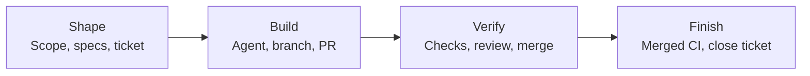

# How the tools fit together

| Tool | Responsibility |
| --- | --- |
| **ai-dlc CLI + local MCP server** | Setup, configuration rendering, work records, document tools, and completion gates. MCP exposes selected services to agents; machine mutations stay in the CLI. |
| **Claude Code / Codex** | Interactive development using shared instructions and skills for discovery, PRDs, specifications, and handoffs. |
| **uv + mise** | Python environments and dependencies, pinned runtimes, and delegated tool installation. |
| **Copier** | Project templates, recorded template versions, and staged updates. |
| **OpenSpec** | Formal requirements, scenarios, and archived changes when the work needs a specification. |
| **GitHub Issues + Projects / GitHub Actions** | Ticket identity and planning, PR review and merge, and CI evidence. |
| **Obsidian** | Private continuity notes and navigation to canonical repository documents. |

## Providers and hangar

Provider roles are configurable. GitHub Issues + Projects is the default and
recommended tracker with recorded live evidence. The Jira Cloud adapter is
available; its live workflow qualification is pending. The Plane adapter is
unsupported and unqualified. The Linear adapter is removed (see the
[migration guide](../migration.md#tracker-defaults-and-removed-linear-adapter)).

Agent jobs enter through hangar intake. Moving a ticket to a status, label or
Projects column starts a hangar job, and hangar writes job progress back to the
ticket. ai-dlc is the local developer loop around that ticket: a work record,
branch binding and specification artifacts, then a gated `work finish`. The
[tracker boundary](../architecture.md#tracker-boundary-with-hangar) says which
tool writes what.

For agent access, register `ai-dlc mcp serve --root /absolute/path/to/project`
as a stdio MCP server in your client. The [tool map](tool-map.md) lists commands,
MCP tools and skills.

## Feature details

- **Repeatable setup.** Versioned profiles select runtimes, tools, and personal
  agent settings. Each machine keeps its own paths and account bindings.
- **Project scaffolding and updates.** Start or adopt a generic, Python, Node, or
  Rust project. Copier templates provide shared instructions, documentation,
  setup commands, and checks, with previews for adoption and updates.
- **Shared agent guidance.** Render project instructions, skills, hooks, and MCP
  configuration for supported clients. Subscribe to pinned team repositories,
  filter by role or tag, and import supported Tencent teamai layouts.
- **Tickets connected to delivery.** Bind reviewed scope and specifications to a
  ticket, branch, and PR. Completion verifies the merged revision and its CI
  receipts before closing the ticket.
- **Repository docs and private knowledge.** Search project documents, review
  documentation impact, and check ownership and links. Connect canonical project
  docs to an existing Obsidian vault while keeping personal notes separate.
- **Engagement and design workflows.** Scaffold seven-stage forward-deployed
  engineering (FDE) engagement docs with local stage checks. Optional frontend
  tooling captures Playwright evidence for design review.
